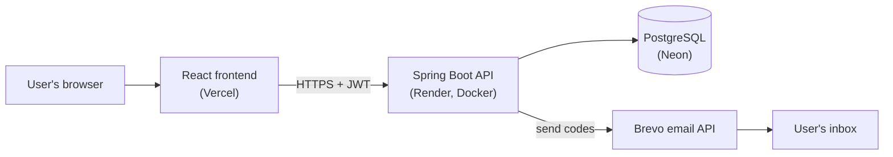
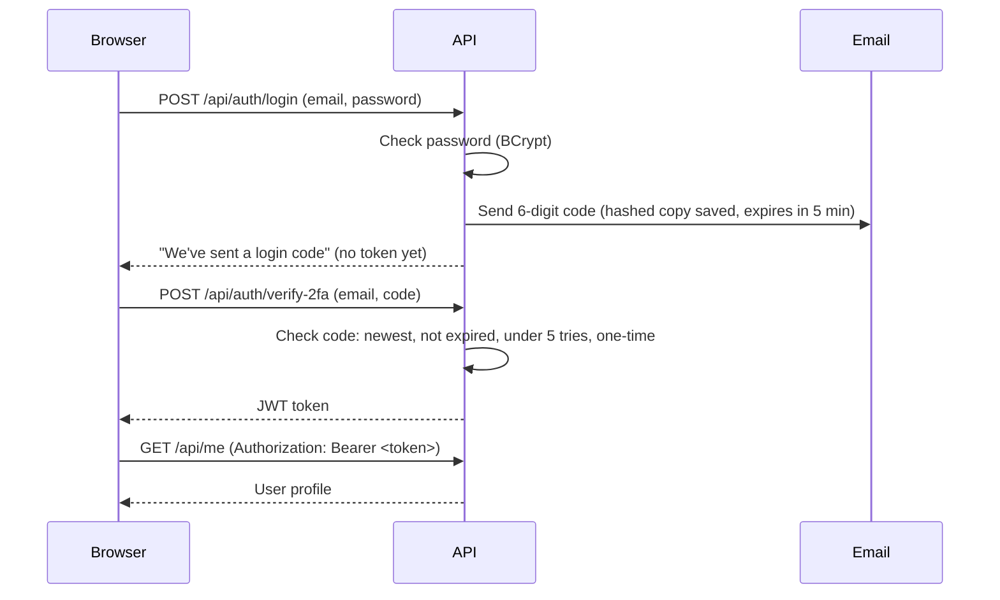
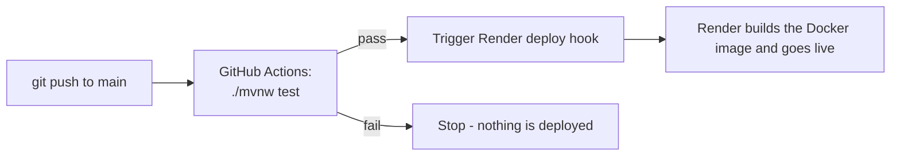

# Learning Platform - Backend

[](https://github.com/mishaSethi/learning-platform/actions/workflows/ci.yml)

REST API for a Himalaya-themed learning platform: secure sign-up and login with **email two-factor authentication**, password reset, and a **server-graded quiz** with attempt history. Built with Spring Boot 3 and Java 21, deployed automatically through a GitHub Actions CI/CD pipeline - entirely on free hosting.

**Live**
- Website: https://learning-platform-frontend-six.vercel.app
- API: https://learning-platform-backend-b52m.onrender.com/api/health
- Frontend code: https://github.com/mishaSethi/learning-platform-frontend

> The API runs on Render's free plan, so the first request after a quiet period can take up to a minute while the server wakes up.

---

## Features

**Accounts and security**
- Sign up and log in with validated input; passwords stored only as **BCrypt hashes**
- **Email 2FA at every login** - the password alone never returns a token
- **Forgot password** with a 6-digit email code
- Stateless authentication with **JWT** (24-hour tokens)
- Emails are case-insensitive, and login errors never reveal whether an email is registered

**Verification codes (2FA and password reset)**
- Generated with `SecureRandom`, stored **hashed**, never in plain text
- Expire after 5 minutes (login) or 15 minutes (reset)
- Blocked after **5 wrong attempts**, and usable **only once**
- A new code cancels older ones; 2FA and reset codes are kept separate, so one never cancels the other

**Himalaya quiz**
- 10 random multiple-choice questions per attempt, from a question bank stored in the database
- Questions are sent **without the correct answers** - marking happens on the server
- Rejects tampered submissions (wrong number of answers, repeated or unknown questions, invalid options)
- Saves every attempt and returns a full review with explanations

**Engineering**
- **CI/CD:** every push runs the tests; only a green build is deployed
- CORS restricted to the real frontend, with preflight responses cached for an hour
- Emails sent asynchronously so requests don't wait on the mail provider
- Secrets only in environment variables - nothing sensitive in the repository

---

## Tech stack

| Layer | Technology |
| --- | --- |
| Language | Java 21 |
| Framework | Spring Boot 3.5 (Web, Data JPA, Validation, Security) |
| Authentication | Spring Security, JWT (jjwt 0.12), BCrypt |
| Database | PostgreSQL on **Neon** (cloud); H2 in-memory for tests |
| Email | **Brevo** transactional email API |
| Build | Maven (wrapper included) |
| CI/CD | **GitHub Actions** |
| Hosting | **Render** (Docker) |

---

## Architecture



### Login with two-factor authentication



### CI/CD pipeline



Render's own auto-deploy is turned off, so **only code that passes the tests reaches production**.

---

## API reference

All request and response bodies are JSON. 🔒 = needs `Authorization: Bearer <token>`.

### Public

| Method | Endpoint | Body | Returns |
| --- | --- | --- | --- |
| GET | `/api/health` | - | `{"status": "Backend is running"}` |
| POST | `/api/auth/signup` | `name`, `email`, `password` (min 6), `phone` (optional) | `201` user (no password) · `409` email taken |
| POST | `/api/auth/login` | `email`, `password` | Message; a 2FA code is emailed · `401` wrong details |
| POST | `/api/auth/verify-2fa` | `email`, `code` (6 digits) | `{"token": "..."}` · `401` invalid or expired code |
| POST | `/api/auth/forgot-password` | `email` | The same message whether or not the email exists |
| POST | `/api/auth/reset-password` | `email`, `code`, `newPassword` (min 6) | Message · `400` invalid or expired code |

### Logged in 🔒

| Method | Endpoint | Body | Returns |
| --- | --- | --- | --- |
| GET | `/api/me` | - | The current user |
| GET | `/api/quiz/questions` | - | 10 random questions (`id`, `text`, `options`) - **no answers** |
| POST | `/api/quiz/submit` | `answers`: 10 × `{questionId, selectedOption}` (0-3, or `null` to skip) | `score`, `total`, and a review with correct answers and explanations |
| GET | `/api/quiz/attempts` | - | The user's 20 most recent attempts, newest first |

---

## Running locally

**Prerequisites:** Java 21, a PostgreSQL database (a free [Neon](https://neon.tech) project works), and a free [Brevo](https://www.brevo.com) account for emails.

1. Clone the repository
   ```bash
   git clone https://github.com/mishaSethi/learning-platform.git
   cd learning-platform
   ```
2. Create a `.env` file in the project root (it is git-ignored) with the variables below.
3. Run the API
   ```bash
   ./mvnw spring-boot:run
   ```
   It starts on http://localhost:8080 - check http://localhost:8080/api/health. Tables are created automatically, and the quiz is filled with starter questions on the first run.

### Environment variables

| Variable | Required | Description |
| --- | --- | --- |
| `DATABASE_URL` | Yes | JDBC URL, e.g. `jdbc:postgresql://HOST/DATABASE?sslmode=require` |
| `DB_USERNAME` | Yes | Database user |
| `DB_PASSWORD` | Yes | Database password |
| `JWT_SECRET` | Yes | Base64-encoded random key, at least 32 bytes |
| `BREVO_API_KEY` | Yes | Brevo API key (`xkeysib-...`) |
| `MAIL_FROM` | Yes | Sender address verified in Brevo |
| `CORS_ALLOWED_ORIGINS` | No | Comma-separated frontend URLs (default `http://localhost:5173`) |
| `JWT_EXPIRATION_MS` | No | Token lifetime (default `86400000` = 24 hours) |
| `PORT` | No | Server port (default `8080`) |
| `DB_POOL_SIZE` | No | Database connection pool size (default `5`) |

Generate a `JWT_SECRET` in PowerShell:
```powershell
$b = New-Object byte[] 32; [Security.Cryptography.RandomNumberGenerator]::Create().GetBytes($b); [Convert]::ToBase64String($b)
```
or on macOS / Linux: `openssl rand -base64 32`

---

## Tests

```bash
./mvnw test
```

Tests run against an **in-memory H2 database** with test-only settings (`src/test/resources/application-test.properties`), so they need no real database, secrets or email account - the same command runs in GitHub Actions.

---

## Project structure

```
src/main/java/com/learningplatform/backend
├── config/        Startup tasks: database connection check, quiz question seeder
├── controller/    REST endpoints: auth, user, quiz, health
├── dto/           Request and response shapes (records)
├── entity/        Database tables: User, VerificationCode, QuizQuestion, QuizAttempt
├── repository/    Spring Data JPA repositories
├── security/      Security rules, CORS, JWT creation and the JWT filter
└── service/       Business logic: auth, verification codes, email, quiz
```

---

## Deployment

- **Dockerfile:** a two-stage build - Maven builds the jar on a JDK image, and a slim JRE image runs it.
- **Render:** a free web service built from the Dockerfile, with secrets set as environment variables in Render's dashboard. Auto-deploy is off; GitHub Actions triggers the deploy hook only after tests pass.
- **Database:** Neon serverless PostgreSQL.

---

## Roadmap

- [ ] Quiz screens in the dashboard
- [ ] Trusted devices ("remember this device" to skip 2FA)
- [ ] Trek booking form with an admin approval panel (USER / ADMIN roles)
- [ ] Analytics page with charts
- [ ] API documentation with Swagger (springdoc-openapi)
- [ ] More automated tests for login, 2FA, reset and the quiz
- [ ] Database migrations with Flyway
